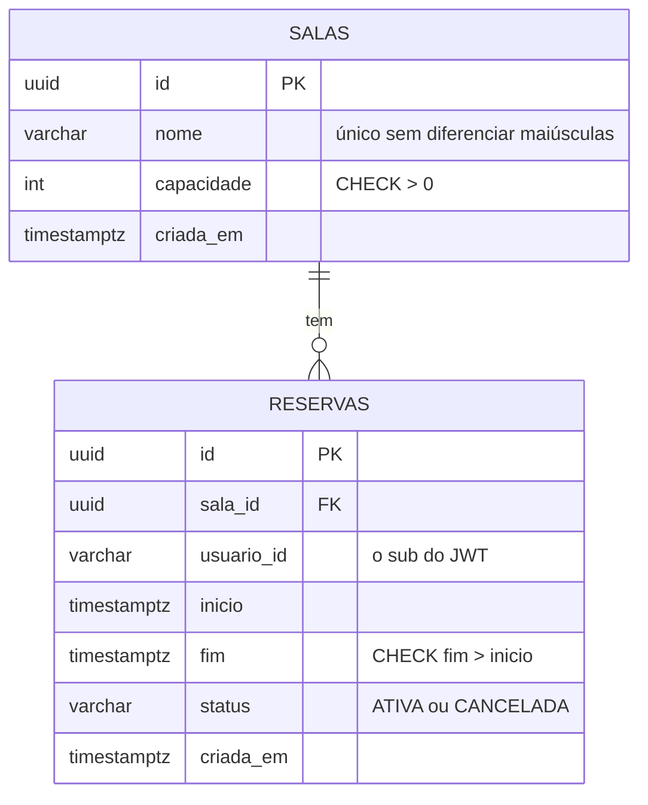

# room-booking-api


API de reservas de salas por horário, com Spring Boot e PostgreSQL: impede que duas pessoas ocupem o mesmo intervalo,
autentica com Keycloak, faz cache em Redis e expõe métricas no Grafana. Tudo roda local com Docker Compose.

> **Status:** projeto de estudo, em construção. Prontos: o modelo relacional, o CRUD e a autenticação com autorização
> (Etapas 0 a 2). **A API ainda aceita duas reservas no mesmo horário**: isso é de propósito e é o assunto da Etapa 3.
> O que não existe está marcado como "a fazer".

## Problema

Reservar uma sala parece um CRUD, mas tem três dificuldades que um CRUD simples não mostra:

1. **Concorrência:** duas pessoas reservam a mesma sala no mesmo horário ao mesmo tempo. "Consultar se há conflito e
   inserir" tem uma janela de corrida; só o banco (ou um lock) fecha essa janela.
2. **Segurança:** quem pode ler, quem pode escrever e quem pode cancelar a reserva de quem. O dono vem do token, nunca do
   corpo da requisição.
3. **Operação:** quando a API fica lenta ou devolve erro, achar a causa (métrica, log e trace) em vez de adivinhar.

O domínio é pequeno de propósito. Sala tem `id`, `nome` e `capacidade`. Reserva tem `id`, `salaId`, `usuarioId` (o `sub`
do JWT), `inicio`, `fim` e `status`. Usuários e senhas ficam só no Keycloak.

## Arquitetura




O controller só recebe e devolve, a regra fica no service, e a entidade JPA nunca sai da API (as respostas são `record`s).
O **Flyway é dono do schema** (`src/main/resources/db/migration`): o Hibernate roda com `ddl-auto=validate`, ou seja, só
confere se as entidades batem com o banco e nunca cria nem altera tabela. Pacotes: `sala`, `reserva` e `comum`
(erros, paginação e datas) e `seguranca` (filtros, papéis e respostas 401 e 403).

O cache (Redis) e a observabilidade (Prometheus e Grafana) entram nas Etapas 4 e 5.

## Tecnologias

| Peça | Escolha |
|---|---|
| Linguagem e framework | Java 25 e Spring Boot 4.1.2 (Web MVC, Data JPA, Bean Validation, Actuator) |
| Banco | PostgreSQL 17, com Flyway para o schema e o Hibernate só validando (`ddl-auto=validate`) |
| Segurança | Spring Security 7 como resource server JWT, com Keycloak 26.8.1 (realm importado de JSON versionado) |
| Cache | Redis (a fazer, Etapa 4) |
| Observabilidade | Micrometer, OpenTelemetry, Prometheus e Grafana (a fazer, Etapa 5) |
| Testes | JUnit 5 e Testcontainers com PostgreSQL de verdade, sem mock de banco; tokens JWT reais assinados com uma chave de teste |
| Build | Maven com wrapper (`./mvnw`), sem instalar o Maven |

## Como rodar

Requisitos: JDK 25 e Docker.

```bash
docker compose up -d         # PostgreSQL 17 (porta 5432, com volume) e Keycloak (porta 8180)
./mvnw spring-boot:run       # a API sobe na porta 8080 e o Flyway aplica as migrations
docker compose down -v       # para tudo e apaga o volume
```

No Windows (PowerShell), use `.\mvnw.cmd spring-boot:run`. As senhas do banco (`reservas`), do administrador do Keycloak
(`admin`) e dos usuários do realm são **só para desenvolvimento local** e estão no `docker-compose.yml`, no
`application.properties` e no JSON do realm; em outro ambiente, sobrescreva por `SPRING_DATASOURCE_URL`,
`SPRING_DATASOURCE_USERNAME`, `SPRING_DATASOURCE_PASSWORD` e `KEYCLOAK_ISSUER_URI`.

Testes (precisam de Docker: o Testcontainers sobe um PostgreSQL 17 de verdade, sem mock de banco; o Keycloak não é
necessário, os testes usam tokens assinados com uma chave de teste):

```bash
./mvnw -B verify
```

### Endpoints

| Método e caminho | O que faz |
|---|---|
| `POST /salas` | Cria uma sala (`201` com `Location`); nome repetido, sem diferenciar maiúsculas, dá `409` |
| `GET /salas` | Lista as salas em ordem alfabética |
| `GET /salas/{id}` | Busca uma sala |
| `PUT /salas/{id}` | Atualiza nome e capacidade |
| `DELETE /salas/{id}` | Remove a sala; `409` se ela tem reservas |
| `POST /reservas` | Cria uma reserva `ATIVA` em nome do **usuário do token** (`201` com `Location`); `404` se a sala não existe, `400` se `fim` não é depois de `inicio` |
| `GET /reservas/{id}` | Busca uma reserva |
| `GET /reservas?salaId=&de=&ate=&pagina=&tamanho=` | Reservas que se sobrepõem a `[de, ate)`, da sala informada; todos os filtros são opcionais; `pagina` ≥ 0 (padrão 0) e `tamanho` de 1 a 100 (padrão 20); ordem por início |
| `DELETE /reservas/{id}` | **Cancela** (muda o status para `CANCELADA`, `204`); só o dono (`403` para os outros); cancelar de novo também dá `204` |

Datas em ISO-8601 com `Z` (por exemplo `2026-11-10T10:00:00Z`). Erros no formato `ProblemDetail` (RFC 9457), com os
campos inválidos em `erros`. Todas as rotas (menos a saúde) exigem o token: veja "Segurança", abaixo. Os exemplos desta
seção são da Etapa 1 (API ainda sem token) e mostram o formato das respostas.

```bash
curl -s -X POST localhost:8080/salas -H "Authorization: Bearer $ADMIN" -H 'Content-Type: application/json' -d '{"nome":"Sala Azul","capacidade":8}'
curl -s -X POST localhost:8080/reservas -H "Authorization: Bearer $ANA" -H 'Content-Type: application/json' \
  -d '{"salaId":"<id da sala>","inicio":"2026-11-10T10:00:00Z","fim":"2026-11-10T11:00:00Z"}'
```

```json
{"id":"9ac546d1-246e-4d6f-b43e-42eebaa7481d","nome":"Sala Azul","capacidade":8,"criadaEm":"2026-11-04T18:43:08.409936Z"}
{"id":"e77eae3a-...","salaId":"9ac546d1-...","salaNome":"Sala Azul","usuarioId":"ana","inicio":"2026-11-10T10:00:00Z","fim":"2026-11-10T11:00:00Z","status":"ATIVA","criadaEm":"2026-11-04T18:43:08.779995Z"}
```

| Situação | Código | Corpo |
|---|---|---|
| Nome de sala repetido (`sala azul`) | `409` | `{"title":"Conflito","detail":"Já existe uma sala chamada 'sala azul'."}` |
| `fim` antes de `inicio` | `400` | `{"title":"Erro de validação","erros":{"intervaloValido":"fim deve ser depois de inicio"}}` |
| Remover sala com reservas | `409` | `{"title":"Conflito","detail":"A sala 9ac546d1-... tem reservas e não pode ser removida."}` |

Listagem paginada (reservas de `bia`, das 11h às 12h; a de `ana`, das 10h às 11h, só encosta no horário e não entra):

```json
{"itens":[{"id":"9b873413-...","salaNome":"Sala Azul","usuarioId":"bia","inicio":"2026-11-10T11:00:00Z","fim":"2026-11-10T12:00:00Z","status":"ATIVA",...}],"pagina":0,"tamanho":10,"total":1,"totalPaginas":1}
```

### Segurança

A API é um **resource server JWT**: ela não guarda usuário nem senha, só valida tokens emitidos pelo Keycloak do
Compose (realm `reservas`, importado de [keycloak/realm-reservas.json](keycloak/realm-reservas.json), sem segredos de
cliente). Um token é aceito se a assinatura confere com as chaves do emissor, não expirou e o `iss` é
`http://localhost:8180/realms/reservas`.

| Rota | Quem pode |
|---|---|
| `GET /actuator/health` | Qualquer um (o orquestrador precisa) |
| `GET /salas`, `GET /salas/{id}` | Qualquer autenticado |
| `POST`, `PUT`, `DELETE` em `/salas` | Só `ADMIN` |
| `POST /reservas`, `GET /reservas`, `GET /reservas/{id}` | Qualquer autenticado |
| `DELETE /reservas/{id}` | **Só quem criou a reserva** (nem o `ADMIN` cancela a de outra pessoa) |
| Todo o resto | Negado por padrão (`403`; sem token, `401`) |

Usuários de desenvolvimento (senhas só para uso local, no JSON do realm): `ana` e `bia` (papel `USER`) e `admin` (papel
`ADMIN`). Para chamar a API:

```bash
TOKEN=$(curl -s -d "client_id=reservas-cli&grant_type=password&username=ana&password=ana-dev" \
  http://localhost:8180/realms/reservas/protocol/openid-connect/token | python -c "import json,sys;print(json.load(sys.stdin)['access_token'])")
curl -s -H "Authorization: Bearer $TOKEN" localhost:8080/salas
```

- **Papéis:** o Keycloak põe os papéis do realm em `realm_access.roles`. O Spring Security só lê o claim `scope`, então um
  `KeycloakRolesConverter` transforma cada papel em `ROLE_<papel>`. Sem ele, `hasRole("ADMIN")` nunca casaria. Um token
  sem o claim (ou com formato inesperado) não tem papel nenhum: nunca vira `ADMIN` por engano. Só `realm_access` conta;
  papéis de cliente (`resource_access`) e `scope` não viram autoridade.
- **O dono vem do token, nunca do corpo:** `POST /reservas` não tem `usuarioId`; o dono é o `sub` do JWT. Um `usuarioId`
  no corpo é ignorado. Cancelar compara o `sub` com o dono da reserva (`404` antes de `403`).
- **CSRF desligado, e por quê:** o CSRF explora o navegador enviando **cookies** sozinho para outro site. Esta API é
  *stateless* e autentica só pelo cabeçalho `Authorization: Bearer`, que o navegador nunca envia sozinho; não há sessão nem
  cookie para forjar. Se um dia a API passasse a usar cookie de sessão, o CSRF teria que voltar.
- **CORS explícito:** só as origens de `app.cors.allowed-origins` (padrão `http://localhost:3000`; mude por
  `CORS_ALLOWED_ORIGINS`), só os métodos `GET, POST, PUT, DELETE, OPTIONS`, só os cabeçalhos `Authorization` e
  `Content-Type`, sem credenciais. Uma origem fora da lista recebe `403` no preflight.
- **401 e 403 no mesmo formato dos outros erros** (`ProblemDetail`), com textos fixos: nada do que o cliente mandou é
  ecoado. O `401` leva `WWW-Authenticate: Bearer`.

**Limitações conhecidas:** a API não valida o `aud` (audiência) do token: serve a qualquer token do realm; para um
cenário real, um mapeador de audiência no Keycloak e um validador na API fechariam isso. O `reservas-cli` usa o fluxo de
senha (`direct access grants`) só por ser prático em desenvolvimento; um front-end usaria o fluxo de código com PKCE. O
Keycloak roda em modo de desenvolvimento (sem HTTPS, banco embutido).

## Decisões

| Decisão | Motivo |
|---|---|
| PostgreSQL com Flyway e `ddl-auto=validate` | O schema fica revisável no Git, e o `validate` impede que entidade e SQL divirjam sem alguém notar. O custo é manter o schema em dois lugares; o `MigracoesTest` e o contexto dos testes (que valida contra um PostgreSQL real) pegam a divergência |
| Regras no banco, além da validação da API: `CHECK (fim > inicio)`, status válido, capacidade > 0, chaves estrangeiras | A API valida e devolve `400` com o campo, mas só o banco garante a regra para qualquer cliente. O `MigracoesTest` prova que o banco recusa, sem passar pela API |
| `DELETE /reservas/{id}` cancela (status `CANCELADA`) em vez de apagar a linha | O histórico importa, e a concorrência da Etapa 3 trata reservas ativas. Cancelar é idempotente (`204` de novo) |
| Reserva sem checar sobreposição **nesta etapa** | É a Etapa 3: primeiro a versão ingênua, depois o teste que reproduz a corrida, depois três correções comparadas. Um teste documenta o comportamento atual e será trocado |
| Intervalos que só se tocam (fim == início) não se sobrepõem | Reservar das 10h às 11h e das 11h às 12h é válido; o filtro por período usa `fim > de` e `inicio < ate` |
| `usuarioId` no corpo do `POST /reservas` (Etapa 1) | Era provisório, sem autenticação. **Removido na Etapa 2:** o dono vem do `sub` do token |
| Ids `UUID` gerados pela aplicação | Não revelam a quantidade de registros e não dependem de sequência do banco |
| Nome da sala único sem diferenciar maiúsculas (índice sobre `lower(nome)`) | "Sala A" e "sala a" são a mesma sala; a consulta evita o erro na maioria dos casos, e o índice barra a corrida |
| Datas em `timestamptz`, truncadas para microssegundos | É a precisão do PostgreSQL. Sem truncar, a resposta do `POST` trazia mais dígitos do que a leitura seguinte |
| Resposta paginada própria (`itens`, `pagina`, `tamanho`, `total`, `totalPaginas`) | O Spring Data avisa que serializar o `PageImpl` direto não tem formato estável |
| Remover sala com reservas: `409` | A chave estrangeira também barraria, mas com um erro de banco; assim a resposta é clara |
| Resource server JWT com Keycloak; a API não guarda usuário nem senha | O roteiro pede um provedor de identidade real; assim os tokens são emitidos e assinados fora da API |
| `reservas-cli` com fluxo de senha, só para desenvolvimento | É o jeito mais curto de obter um token real com `curl`; um front-end usaria código com PKCE |
| Só o dono cancela a reserva, nem o `ADMIN` | É o que o roteiro pede ("só quem criou a reserva a cancela"). Um administrador que precisasse cancelar a de outra pessoa teria que ser uma regra nova, decidida de propósito |
| `404` antes de `403` ao cancelar | Revela que o id existe a quem não é o dono; com UUIDs aleatórios isso não permite enumerar reservas |
| Negar por padrão (`anyRequest().denyAll()`) | O que não foi liberado de propósito não é servido; uma rota nova não nasce pública por esquecimento. O custo: uma rota inexistente dá `403`, e não `404`, a quem está autenticado |
| Qualquer autenticado cria reservas (não exige o papel `USER`) | O roteiro só restringe a escrita de salas; o papel `USER` documenta a intenção, mas não é checado |
| Testes com tokens JWT assinados por uma chave de teste, em vez do atalho `jwt()` do `spring-security-test` | O atalho pula a validação do token e o conversor de papéis; assim 401 (expirado, outro emissor, outra chave) e 403 passam pela cadeia de filtros de verdade |
| Keycloak 26.8.1 (imagem de 31/10/2026) | Confirmada no quay.io; fixada, sem `latest` |
| Nome do projeto `room-booking-api` (pacote `dev.heldem.reservas`) | É o nome do repositório; o domínio do código segue em português |
| Imagem `postgres:17` fixada | O gerador usa `postgres:latest`, que muda sem aviso |
| Spring Boot 4.1.2 (a estável atual do Initializr em 04/11/2026) e não a 4.1.1 do roteiro | O Initializr já oferece a 4.1.2 como padrão |

## Experimentos

### N+1 na listagem (Etapa 1)

`GET /reservas` devolve o nome da sala junto de cada reserva. Com a sala `LAZY` (o certo, para não carregar o que não
se usa), cada reserva de uma sala ainda não carregada dispara uma consulta própria.

Como medir: `ConsultasDaListagemTest` popula as reservas, limpa o contexto de persistência (senão a sessão já teria as
salas e o problema sumiria) e conta os statements preparados pelas estatísticas do Hibernate durante uma só chamada
de `GET /reservas?tamanho=50`. Contei também o SQL (`logging.level.org.hibernate.SQL=DEBUG`) para entender cada número.

| Cenário (50 reservas por página) | Antes (sala `LAZY`) | Depois (`@EntityGraph`) |
|---|---|---|
| Em 50 salas diferentes | **52** consultas | **2** |
| Em 10 salas diferentes | **12** consultas | **2** |

- **Antes:** 1 consulta da página + 1 da contagem + **1 por sala distinta** (`select ... from salas where id=?`). O pior caso
  é uma por reserva; com poucas salas o custo cai, porque a sessão reaproveita a sala já carregada.
- **Depois:** a página vem com um `join` da sala (`@EntityGraph(attributePaths = "sala")` em `findAll(Specification, Pageable)`),
  mais a contagem, que não leva o join. Dois statements, qualquer que seja o número de salas.
- **Por que `@EntityGraph` e não `fetch join`:** o grafo se aplica só à consulta de dados e deixa a de contagem sem join,
  sem código extra. Um `fetch join` escrito dentro da `Specification` valeria também para a contagem (o Spring Data roda a
  mesma `Specification` nas duas), então exigiria tratar esse caso. **Não testei** a alternativa do `fetch join`.
- **Um erro meu na medição:** a primeira contagem deu 54 e 14, porque o `MockMvcTester` é preguiçoso e cada `assertThat`
  sobre a chamada refaz a requisição (a segunda listagem não tinha os selects de sala, mas somava a página e a contagem
  de novo). Percebi pelo SQL, corrigi o teste para chamar uma vez, e os números certos são os da tabela.

As Etapas 3, 4 e 5 acrescentam as tabelas de experimento de concorrência, de cache e de observabilidade.

## Custo

**Zero.** Tudo roda na máquina local com Docker; nada é aplicado na AWS. A parte opcional do roteiro que subiria a API
no ECS não será feita.

## Roteiro

- [x] Etapa 0: repositório, projeto gerado e CI
- [x] Etapa 1: modelo relacional, Flyway e CRUD (migrations, CRUD de salas e reservas, N+1 medido e corrigido)
- [x] Etapa 2: autenticação e autorização (Keycloak, JWT, papéis, regra de dono, 401 e 403 testados)
- [ ] Etapa 3: concorrência e reserva dupla
- [ ] Etapa 4: cache com Redis
- [ ] Etapa 5: observabilidade
- [ ] Etapa 6: entrega

## Licença

MIT. Veja [LICENSE](LICENSE).
