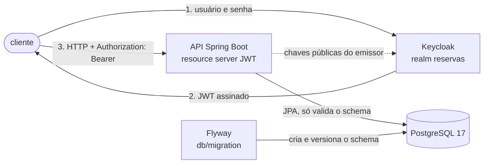
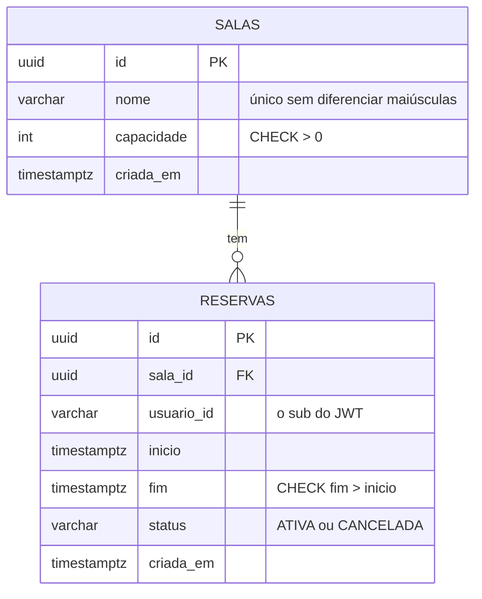
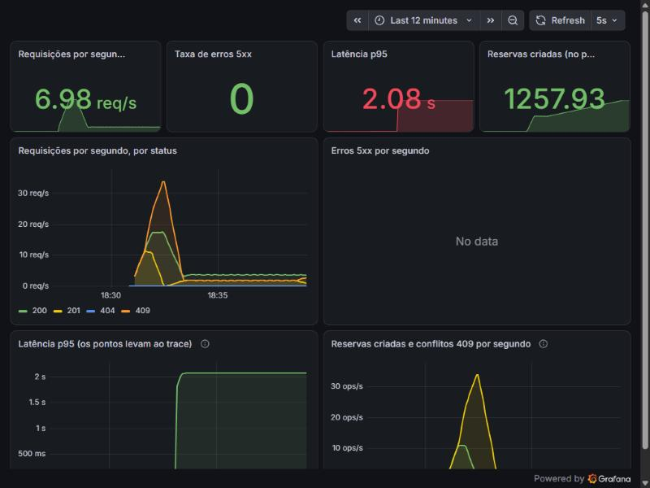
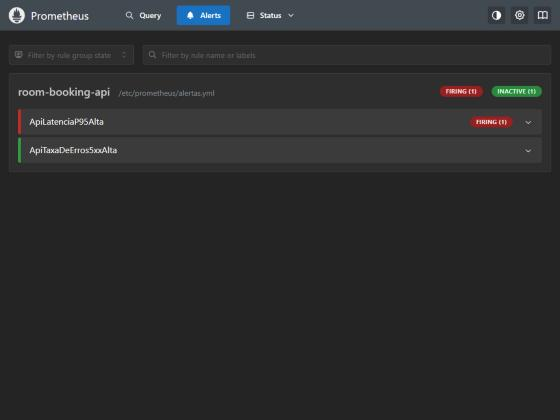
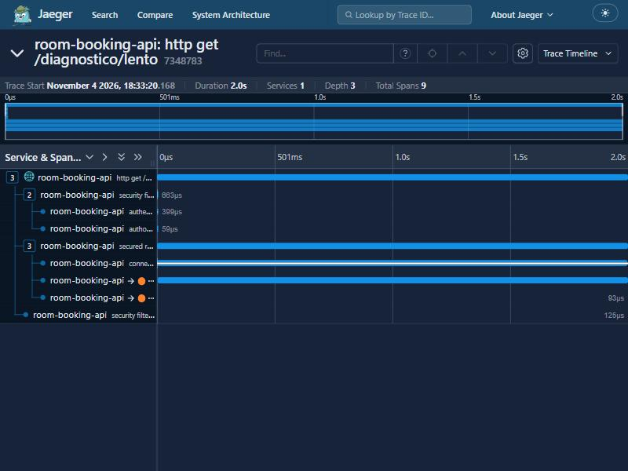

# room-booking-api


API de reservas de salas por horário, com Spring Boot e PostgreSQL: impede que duas pessoas ocupem o mesmo intervalo,
autentica com Keycloak, faz cache em Redis e expõe métricas no Grafana. Tudo roda local com Docker Compose.

> **Status:** projeto de estudo, em construção. Prontos: o modelo relacional, o CRUD, a autenticação com autorização e a
> proteção contra reserva dupla, com a corrida medida, o cache com Redis, a observabilidade com um experimento
> de lentidão e a entrega (imagem, CI e teste de carga) (Etapas 0 a 6).
> O que não existe está marcado como "a fazer".

## Problema

Reservar uma sala parece um CRUD, mas tem três dificuldades que um CRUD simples não mostra:

1. **Concorrência:** duas pessoas reservam a mesma sala no mesmo horário ao mesmo tempo. "Consultar se há conflito e
   inserir" tem uma janela de corrida; só o banco (ou um lock) fecha essa janela.
2. **Segurança:** quem pode ler, quem pode escrever e quem pode cancelar a reserva de quem. O dono vem do token, nunca do
   corpo da requisição.
3. **Operação:** quando a API fica lenta ou devolve erro, achar a causa (métrica, log e trace) em vez de adivinhar.

O domínio é pequeno de propósito. Sala tem `id`, `nome` e `capacidade`. Reserva tem `id`, `salaId`, `usuarioId` (o `sub`
do JWT), `inicio`, `fim` e `status`. Usuários e senhas ficam só no Keycloak.

## Arquitetura





O controller só recebe e devolve, a regra fica no service, e a entidade JPA nunca sai da API (as respostas são `record`s).
O **Flyway é dono do schema** (`src/main/resources/db/migration`): o Hibernate roda com `ddl-auto=validate`, ou seja, só
confere se as entidades batem com o banco e nunca cria nem altera tabela. Pacotes: `sala`, `reserva` e `comum`
(erros, paginação e datas) e `seguranca` (filtros, papéis e respostas 401 e 403).

A observabilidade (Prometheus e Grafana) entra na Etapa 5.

## Tecnologias

| Peça | Escolha |
|---|---|
| Linguagem e framework | Java 25 e Spring Boot 4.1.2 (Web MVC, Data JPA, Bean Validation, Actuator) |
| Banco | PostgreSQL 17, com Flyway para o schema e o Hibernate só validando (`ddl-auto=validate`) |
| Segurança | Spring Security 7 como resource server JWT, com Keycloak 26.8.1 (realm importado de JSON versionado) |
| Cache | Redis 8, com `spring-boot-starter-data-redis` e `spring-boot-starter-cache` (Etapa 4) |
| Observabilidade | Micrometer, OpenTelemetry (traces OTLP), Prometheus, Grafana e Jaeger, logs JSON com `traceId` (Etapa 5) |
| Testes | JUnit 5 e Testcontainers com PostgreSQL de verdade, sem mock de banco; tokens JWT reais assinados com uma chave de teste |
| Build | Maven com wrapper (`./mvnw`), sem instalar o Maven |

## Como rodar

Requisitos: JDK 25 e Docker.

```bash
docker compose up -d         # PostgreSQL 17 (5432, com volume), Keycloak (8180), Redis (6379), Prometheus (9090), Grafana (3001) e Jaeger (16686)
./mvnw spring-boot:run       # a API sobe na porta 8080 e o Flyway aplica as migrations
docker compose down -v       # para tudo e apaga o volume
```

No Windows (PowerShell), use `.\mvnw.cmd spring-boot:run`. As senhas do banco (`reservas`), do administrador do Keycloak
(`admin`) e dos usuários do realm são **só para desenvolvimento local** e estão no `docker-compose.yml`, no
`application.properties` e no JSON do realm; em outro ambiente, sobrescreva por `SPRING_DATASOURCE_URL`,
`SPRING_DATASOURCE_USERNAME`, `SPRING_DATASOURCE_PASSWORD` e `KEYCLOAK_ISSUER_URI`.

Testes (precisam de Docker: o Testcontainers sobe um PostgreSQL 17 de verdade, sem mock de banco; o Keycloak não é
necessário, os testes usam tokens assinados com uma chave de teste):

```bash
./mvnw -B verify
```

### Endpoints

| Método e caminho | O que faz |
|---|---|
| `POST /salas` | Cria uma sala (`201` com `Location`); nome repetido, sem diferenciar maiúsculas, dá `409` |
| `GET /salas` | Lista as salas em ordem alfabética |
| `GET /salas/{id}` | Busca uma sala |
| `PUT /salas/{id}` | Atualiza nome e capacidade |
| `DELETE /salas/{id}` | Remove a sala; `409` se ela tem reservas |
| `POST /reservas` | Cria uma reserva `ATIVA` em nome do **usuário do token** (`201` com `Location`); `404` se a sala não existe, `400` se `fim` não é depois de `inicio`, **`409` se o horário já está ocupado**. Aceita `Idempotency-Key` (veja Experimentos) |
| `GET /reservas/{id}` | Busca uma reserva |
| `GET /reservas?salaId=&de=&ate=&pagina=&tamanho=` | Reservas que se sobrepõem a `[de, ate)`, da sala informada; todos os filtros são opcionais; `pagina` ≥ 0 (padrão 0) e `tamanho` de 1 a 100 (padrão 20); ordem por início |
| `DELETE /reservas/{id}` | **Cancela** (muda o status para `CANCELADA`, `204`); só o dono (`403` para os outros); cancelar de novo também dá `204` |

Datas em ISO-8601 com `Z` (por exemplo `2026-11-10T10:00:00Z`). Erros no formato `ProblemDetail` (RFC 9457), com os
campos inválidos em `erros`. Todas as rotas (menos a saúde) exigem o token: veja "Segurança", abaixo. Os exemplos desta
seção são da Etapa 1 (API ainda sem token) e mostram o formato das respostas.

```bash
curl -s -X POST localhost:8080/salas -H "Authorization: Bearer $ADMIN" -H 'Content-Type: application/json' -d '{"nome":"Sala Azul","capacidade":8}'
curl -s -X POST localhost:8080/reservas -H "Authorization: Bearer $ANA" -H 'Content-Type: application/json' \
  -d '{"salaId":"<id da sala>","inicio":"2026-11-10T10:00:00Z","fim":"2026-11-10T11:00:00Z"}'
```

```json
{"id":"9ac546d1-246e-4d6f-b43e-42eebaa7481d","nome":"Sala Azul","capacidade":8,"criadaEm":"2026-11-04T18:43:08.409936Z"}
{"id":"e77eae3a-...","salaId":"9ac546d1-...","salaNome":"Sala Azul","usuarioId":"ana","inicio":"2026-11-10T10:00:00Z","fim":"2026-11-10T11:00:00Z","status":"ATIVA","criadaEm":"2026-11-04T18:43:08.779995Z"}
```

| Situação | Código | Corpo |
|---|---|---|
| Nome de sala repetido (`sala azul`) | `409` | `{"title":"Conflito","detail":"Já existe uma sala chamada 'sala azul'."}` |
| `fim` antes de `inicio` | `400` | `{"title":"Erro de validação","erros":{"intervaloValido":"fim deve ser depois de inicio"}}` |
| Remover sala com reservas | `409` | `{"title":"Conflito","detail":"A sala 9ac546d1-... tem reservas e não pode ser removida."}` |

Listagem paginada (reservas de `bia`, das 11h às 12h; a de `ana`, das 10h às 11h, só encosta no horário e não entra):

```json
{"itens":[{"id":"9b873413-...","salaNome":"Sala Azul","usuarioId":"bia","inicio":"2026-11-10T11:00:00Z","fim":"2026-11-10T12:00:00Z","status":"ATIVA",...}],"pagina":0,"tamanho":10,"total":1,"totalPaginas":1}
```

### Segurança

A API é um **resource server JWT**: ela não guarda usuário nem senha, só valida tokens emitidos pelo Keycloak do
Compose (realm `reservas`, importado de [keycloak/realm-reservas.json](keycloak/realm-reservas.json), sem segredos de
cliente). Um token é aceito se a assinatura confere com as chaves do emissor, não expirou e o `iss` é
`http://localhost:8180/realms/reservas`.

| Rota | Quem pode |
|---|---|
| `GET /actuator/health` | Qualquer um (o orquestrador precisa) |
| `GET /salas`, `GET /salas/{id}` | Qualquer autenticado |
| `POST`, `PUT`, `DELETE` em `/salas` | Só `ADMIN` |
| `POST /reservas`, `GET /reservas`, `GET /reservas/{id}` | Qualquer autenticado |
| `DELETE /reservas/{id}` | **Só quem criou a reserva** (nem o `ADMIN` cancela a de outra pessoa) |
| Todo o resto | Negado por padrão (`403`; sem token, `401`) |

Usuários de desenvolvimento (senhas só para uso local, no JSON do realm): `ana` e `bia` (papel `USER`) e `admin` (papel
`ADMIN`). Para chamar a API:

```bash
TOKEN=$(curl -s -d "client_id=reservas-cli&grant_type=password&username=ana&password=ana-dev" \
  http://localhost:8180/realms/reservas/protocol/openid-connect/token | python -c "import json,sys;print(json.load(sys.stdin)['access_token'])")
curl -s -H "Authorization: Bearer $TOKEN" localhost:8080/salas
```

- **Papéis:** o Keycloak põe os papéis do realm em `realm_access.roles`. O Spring Security só lê o claim `scope`, então um
  `KeycloakRolesConverter` transforma cada papel em `ROLE_<papel>`. Sem ele, `hasRole("ADMIN")` nunca casaria. Um token
  sem o claim (ou com formato inesperado) não tem papel nenhum: nunca vira `ADMIN` por engano. Só `realm_access` conta;
  papéis de cliente (`resource_access`) e `scope` não viram autoridade.
- **O dono vem do token, nunca do corpo:** `POST /reservas` não tem `usuarioId`; o dono é o `sub` do JWT. Um `usuarioId`
  no corpo é ignorado. Cancelar compara o `sub` com o dono da reserva (`404` antes de `403`).
- **CSRF desligado, e por quê:** o CSRF explora o navegador enviando **cookies** sozinho para outro site. Esta API é
  *stateless* e autentica só pelo cabeçalho `Authorization: Bearer`, que o navegador nunca envia sozinho; não há sessão nem
  cookie para forjar. Se um dia a API passasse a usar cookie de sessão, o CSRF teria que voltar.
- **CORS explícito:** só as origens de `app.cors.allowed-origins` (padrão `http://localhost:3000`; mude por
  `CORS_ALLOWED_ORIGINS`), só os métodos `GET, POST, PUT, DELETE, OPTIONS`, só os cabeçalhos `Authorization` e
  `Content-Type`, sem credenciais. Uma origem fora da lista recebe `403` no preflight.
- **401 e 403 no mesmo formato dos outros erros** (`ProblemDetail`), com textos fixos: nada do que o cliente mandou é
  ecoado. O `401` leva `WWW-Authenticate: Bearer`.

**Limitações conhecidas:** a API não valida o `aud` (audiência) do token: serve a qualquer token do realm; para um
cenário real, um mapeador de audiência no Keycloak e um validador na API fechariam isso. O `reservas-cli` usa o fluxo de
senha (`direct access grants`) só por ser prático em desenvolvimento; um front-end usaria o fluxo de código com PKCE. O
Keycloak roda em modo de desenvolvimento (sem HTTPS, banco embutido).

## Decisões

| Decisão | Motivo |
|---|---|
| PostgreSQL com Flyway e `ddl-auto=validate` | O schema fica revisável no Git, e o `validate` impede que entidade e SQL divirjam sem alguém notar. O custo é manter o schema em dois lugares; o `MigracoesTest` e o contexto dos testes (que valida contra um PostgreSQL real) pegam a divergência |
| Regras no banco, além da validação da API: `CHECK (fim > inicio)`, status válido, capacidade > 0, chaves estrangeiras | A API valida e devolve `400` com o campo, mas só o banco garante a regra para qualquer cliente. O `MigracoesTest` prova que o banco recusa, sem passar pela API |
| `DELETE /reservas/{id}` cancela (status `CANCELADA`) em vez de apagar a linha | O histórico importa, e a concorrência da Etapa 3 trata reservas ativas. Cancelar é idempotente (`204` de novo) |
| Reserva dupla: **exclusion constraint do PostgreSQL + lock pessimista na sala** | A constraint é a garantia (vale para qualquer escritor); o lock é a fila que evita a cauda de deadlocks da constraint sob disputa. Medido, com as três soluções e a hipótese do otimista, em Experimentos |
| A consulta de sobreposição continua, mesmo com a constraint | Dá o `409` claro no caso comum sem um erro de banco; a constraint fecha o que a consulta não enxerga |
| Violação da constraint (`23P01`) e deadlock (`40P01`) viram `409`, nunca `500` | São conflitos de concorrência, não erros do servidor; o `40P01` foi um achado do experimento |
| Lock otimista: a perdedora vira `409` (sem retentativa automática) | Uma retentativa transformaria o `409` genérico no `409` "sala ocupada", mas custa mais uma ida ao banco; o cliente já sabe tentar de novo |
| `Idempotency-Key` opcional, por usuário, só respostas de sucesso memorizadas | Quem não manda a chave continua funcionando (e leva `409` se repetir); a falha não pode consumir a chave, senão o cliente nunca conseguiria tentar de novo |
| Pool de 50 conexões só nos testes de concorrência | Para 50 clientes disputarem de verdade; com o padrão de 10, as outras esperariam por conexão |
| Um só PostgreSQL nos testes, em vez de um por contexto do Spring | Cada contexto com propriedades diferentes subia o seu contêiner; um compartilhado cortou o tempo (o `MigracoesTest` foi de uns 8 s para uns 0,8 s) |
| Intervalos que só se tocam (fim == início) não se sobrepõem | Reservar das 10h às 11h e das 11h às 12h é válido; o filtro por período usa `fim > de` e `inicio < ate` |
| `usuarioId` no corpo do `POST /reservas` (Etapa 1) | Era provisório, sem autenticação. **Removido na Etapa 2:** o dono vem do `sub` do token |
| Ids `UUID` gerados pela aplicação | Não revelam a quantidade de registros e não dependem de sequência do banco |
| Nome da sala único sem diferenciar maiúsculas (índice sobre `lower(nome)`) | "Sala A" e "sala a" são a mesma sala; a consulta evita o erro na maioria dos casos, e o índice barra a corrida |
| Datas em `timestamptz`, truncadas para microssegundos | É a precisão do PostgreSQL. Sem truncar, a resposta do `POST` trazia mais dígitos do que a leitura seguinte |
| Resposta paginada própria (`itens`, `pagina`, `tamanho`, `total`, `totalPaginas`) | O Spring Data avisa que serializar o `PageImpl` direto não tem formato estável |
| Remover sala com reservas: `409` | A chave estrangeira também barraria, mas com um erro de banco; assim a resposta é clara |
| Resource server JWT com Keycloak; a API não guarda usuário nem senha | O roteiro pede um provedor de identidade real; assim os tokens são emitidos e assinados fora da API |
| `reservas-cli` com fluxo de senha, só para desenvolvimento | É o jeito mais curto de obter um token real com `curl`; um front-end usaria código com PKCE |
| Só o dono cancela a reserva, nem o `ADMIN` | É o que o roteiro pede ("só quem criou a reserva a cancela"). Um administrador que precisasse cancelar a de outra pessoa teria que ser uma regra nova, decidida de propósito |
| `404` antes de `403` ao cancelar | Revela que o id existe a quem não é o dono; com UUIDs aleatórios isso não permite enumerar reservas |
| Negar por padrão (`anyRequest().denyAll()`) | O que não foi liberado de propósito não é servido; uma rota nova não nasce pública por esquecimento. O custo: uma rota inexistente dá `403`, e não `404`, a quem está autenticado |
| Qualquer autenticado cria reservas (não exige o papel `USER`) | O roteiro só restringe a escrita de salas; o papel `USER` documenta a intenção, mas não é checado |
| Testes com tokens JWT assinados por uma chave de teste, em vez do atalho `jwt()` do `spring-security-test` | O atalho pula a validação do token e o conversor de papéis; assim 401 (expirado, outro emissor, outra chave) e 403 passam pela cadeia de filtros de verdade |
| Keycloak 26.8.1 (imagem de 31/10/2026) | Confirmada no quay.io; fixada, sem `latest` |
| Nome do projeto `room-booking-api` (pacote `dev.heldem.reservas`) | É o nome do repositório; o domínio do código segue em português |
| Imagem `postgres:17` fixada | O gerador usa `postgres:latest`, que muda sem aviso |
| Spring Boot 4.1.2 (a estável atual do Initializr em 04/11/2026) e não a 4.1.1 do roteiro | O Initializr já oferece a 4.1.2 como padrão |

## Experimentos

### N+1 na listagem (Etapa 1)

`GET /reservas` devolve o nome da sala junto de cada reserva. Com a sala `LAZY` (o certo, para não carregar o que não
se usa), cada reserva de uma sala ainda não carregada dispara uma consulta própria.

Como medir: `ConsultasDaListagemTest` popula as reservas, limpa o contexto de persistência (senão a sessão já teria as
salas e o problema sumiria) e conta os statements preparados pelas estatísticas do Hibernate durante uma só chamada
de `GET /reservas?tamanho=50`. Contei também o SQL (`logging.level.org.hibernate.SQL=DEBUG`) para entender cada número.

| Cenário (50 reservas por página) | Antes (sala `LAZY`) | Depois (`@EntityGraph`) |
|---|---|---|
| Em 50 salas diferentes | **52** consultas | **2** |
| Em 10 salas diferentes | **12** consultas | **2** |

- **Antes:** 1 consulta da página + 1 da contagem + **1 por sala distinta** (`select ... from salas where id=?`). O pior caso
  é uma por reserva; com poucas salas o custo cai, porque a sessão reaproveita a sala já carregada.
- **Depois:** a página vem com um `join` da sala (`@EntityGraph(attributePaths = "sala")` em `findAll(Specification, Pageable)`),
  mais a contagem, que não leva o join. Dois statements, qualquer que seja o número de salas.
- **Por que `@EntityGraph` e não `fetch join`:** o grafo se aplica só à consulta de dados e deixa a de contagem sem join,
  sem código extra. Um `fetch join` escrito dentro da `Specification` valeria também para a contagem (o Spring Data roda a
  mesma `Specification` nas duas), então exigiria tratar esse caso. **Não testei** a alternativa do `fetch join`.
- **Um erro meu na medição:** a primeira contagem deu 54 e 14, porque o `MockMvcTester` é preguiçoso e cada `assertThat`
  sobre a chamada refaz a requisição (a segunda listagem não tinha os selects de sala, mas somava a página e a contagem
  de novo). Percebi pelo SQL, corrigi o teste para chamar uma vez, e os números certos são os da tabela.

As Etapas 3, 4 e 5 acrescentam as tabelas de experimento de concorrência, de cache e de observabilidade.

### Corrida da reserva dupla (Etapa 3)

**O problema.** "Consultar se há conflito e inserir" tem uma janela: duas transações consultam ao mesmo tempo, nenhuma
enxerga o `INSERT` ainda não confirmado da outra, e as duas inserem. Em `READ COMMITTED` (o padrão do PostgreSQL) isso
acontece.

**Como foi medido.** `CorridaDeReservasTest`: 50 clientes, cada um com o seu usuário e o seu token, largam juntos (um
`CountDownLatch` serve de portão) para reservar a **mesma sala no mesmo horário** (10h-11h), passando por toda a cadeia de
filtros. Dez rodadas com sala nova a cada uma, mais uma rodada de aquecimento que não entra na conta. A verdade do
resultado é o que ficou **gravado no banco** (`ativasNoBanco`), e não só os códigos HTTP. Pool de 50 conexões (o padrão do
Hikari, 10, faria as outras requisições esperarem por conexão e esconderia a disputa). PostgreSQL 17 no Testcontainers,
na mesma máquina da API. Máquina: Windows 11, 12 CPUs lógicas, 16 GB para o Docker Desktop. Cada linha é uma branch,
medida com o **mesmo teste** (`./mvnw clean test -Dtest='CorridaDeReservasTest#medir' -Dexperimento=true`). Onde há duas
medições, as duas estão listadas, para mostrar a variação.

| Solução | Criadas por rodada (mín/máx/média) | Gravadas no banco | `409` (média) | `500` | Latência por requisição, ms (p50 / p95 / máx) |
|---|---|---|---|---|---|
| Ingênua (consulta e insere) | 2 / 8 / **4,2** | 2 a 8: as mesmas | 45,8 | 0 | 19 / 53 / 67 |
| (a) Exclusion constraint | 1 / 1 / 1 | 1 | 49 | 0 | 17 / **23.030** / 46.043<br>26 / **39.060** / 47.064 |
| (b) Lock otimista (`@Version` na sala) | 1 / 1 / 1 | 1 | 49 | 0 | 16 / 50 / 64<br>20 / 49 / 60 |
| (c) Lock pessimista (`FOR UPDATE` na sala) | 1 / 1 / 1 | 1 | 49 | 0 | 46 / 88 / 114<br>47 / 89 / 117 |
| **Adotada: (c) + (a)** | 1 / 1 / 1 | 1 | 49 | 0 | 51 / 96 / 115<br>57 / 100 / 117 |
| (b) + (a), só para checar uma hipótese | 1 / 1 / 1 | 1 | 49 | 0 | 21 / **37.010** / 48.033<br>25 / **40.027** / 47.053 |

**O que cada linha mostra:**

- **Ingênua:** em **todas as dez rodadas** houve reserva duplicada (de 2 a 8 reservas ativas no mesmo horário). O banco
  confirma os mesmos números das respostas `201`. Sem esse teste, as correções não provariam nada.
- **(a) Exclusion constraint** (`EXCLUDE USING gist (sala_id WITH =, tstzrange(inicio, fim, '[)') WITH &&) WHERE (status =
  'ATIVA')`, com `btree_gist`): **correta**, e é a garantia mais forte, porque vale para qualquer escritor, até SQL
  direto (o `RestricaoDeExclusaoTest` insere 50 linhas em SQL puro e só uma entra). Mas, sob disputa pesada pelo **mesmo**
  horário, o PostgreSQL deixa transações esperando umas pelas outras no índice e as derruba com `deadlock detected`
  (SQLState `40P01`) depois do `deadlock_timeout` (1 s), em cascata: a cauda foi de **23 a 39 s no p95 e 47 s no máximo**.
  Isso apareceu de surpresa: na primeira execução, 49 requisições de uma rodada viraram `500`, porque eu só traduzia o
  `23P01` (violação da constraint) em `409`. Agora o `40P01` também vira `409`.
- **(b) Lock otimista:** a versão precisa morar na **sala**, e não na reserva: numa corrida de *inserção* não há linha de
  reserva para versionar. Cada reserva nova força o incremento da versão da sala (`OPTIMISTIC_FORCE_INCREMENT`); duas
  transações que leram a mesma versão disputam o `UPDATE ... WHERE versao = ?` e só uma vence. A perdedora recebe
  `ObjectOptimisticLockingFailureException`, traduzida em `409`. **Foi a mais rápida** (p95 de 49 a 50 ms). O custo: as
  perdedoras fazem o trabalho todo e só descobrem no commit; e só protege quem passa pelo código que sobe a versão (um
  `INSERT` direto no banco ignora).
- **(c) Lock pessimista:** a transação tranca a linha da sala antes de tudo. As reservas da mesma sala viram uma fila; as
  de salas diferentes seguem em paralelo. Quem espera, ao ser liberado, roda a consulta de sobreposição já enxergando a
  reserva da frente e recebe um `409` com a mensagem certa, sem erro de banco. A latência é a da fila (~2 ms por transação
  × 50): p95 de 88 a 89 ms, **sem cauda**. O custo: quem espera segura uma conexão do pool, e não há limite de espera
  configurado (em produção, `lock_timeout` no PostgreSQL).
- **Adotada, (c) + (a):** o lock serializa as reservas da sala, então a constraint nunca disputa e não há deadlock; a
  constraint continua lá como a garantia que não depende do código. Custo medido sobre o lock sozinho: uns 5 a 10 ms de
  mediana (o índice GiST).
- **(b) + (a), medida só para testar uma hipótese:** a ideia de usar o lock otimista com a constraint parecia boa (o
  otimista é o mais rápido). Mas como no otimista todas as transações inserem ao mesmo tempo e só descobrem no commit, elas
  voltam a disputar o índice da constraint, e **a cauda de deadlocks volta** (p95 de 37 a 40 s). Hipótese confirmada.
  Essa combinação ficou só nesta medição, em uma branch descartada.

**Recomendação escrita.** Use **a constraint como a garantia e o lock pessimista como a fila**:

1. A **exclusion constraint** é o que impede a reserva dupla de verdade: vale para qualquer escritor e sobrevive a um
   bug futuro ou a um `INSERT` manual. Nenhuma das duas soluções de lock oferece isso.
2. O **lock pessimista na sala** evita o custo da constraint sob disputa: sem ele, a cauda de segundos dos deadlocks. É a
   solução com latência previsível e com a mensagem de erro certa para quem perde.
3. O **lock otimista** é a mais rápida e seria a escolha para baixa contenção sem constraint, mas **não** combina com a
   constraint (medido acima) e, sozinha, só protege o código que a usa.
4. **Contexto importante:** 50 clientes no mesmo horário de uma mesma sala é o pior caso, de propósito. Com contenção
   normal (duas ou três pessoas), a consulta de sobreposição deve pegar quase todos os conflitos antes do banco, e a
   constraint sozinha provavelmente bastaria, mas **eu não medi cenários de baixa contenção**. O lock e a constraint
   juntos pagam um custo pequeno e fixo (uns 5 a 10 ms de mediana, medido) para o pior caso não existir.

**Limites deste experimento:** uma única máquina, o PostgreSQL no Docker na mesma máquina (sem latência de rede), um só
cenário de disputa (todos no mesmo horário), dez rodadas por solução. Os números mostram a **forma** do comportamento
(a cauda de deadlocks, a fila), não um desempenho de produção. Os tempos variam entre execuções, por isso as duas medições.

**Onde estão as soluções.** A `main` tem a adotada. As outras ficam em branches para reproduzir a medição:
`etapa-3-exclusion-constraint` (já mesclada), `etapa-3-lock-otimista` e `etapa-3-lock-pessimista`. Ao trocar de branch,
rode `./mvnw clean ...`: o `target/classes` guarda a migration `V3` da branch anterior, e o Flyway recusa duas `V3`.

### Repetição do cliente: Idempotency-Key (Etapa 3)

`POST /reservas` aceita o cabeçalho opcional `Idempotency-Key` (1 a 100 caracteres). Repetir a mesma chave com o mesmo
corpo (um clique duplo, uma retentativa depois de um timeout) devolve **a mesma reserva**, sem criar outra, com o
cabeçalho `Idempotency-Replayed: true`. A chave vale **por usuário**.

Como funciona: a chave é inserida **primeiro**, na mesma transação da reserva, com `ON CONFLICT DO NOTHING`, numa tabela
`chaves_idempotencia` com `UNIQUE (usuario_id, chave)`. O índice único serializa duas requisições simultâneas com a mesma
chave: a segunda espera a primeira confirmar e então devolve a resposta dela. Se a criação falha (`409`, `404`...), a
transação desfaz tudo, inclusive a chave: **só respostas de sucesso são memorizadas**, e o cliente pode tentar de novo.

| Cenário | Resultado observado |
|---|---|
| A mesma chave duas vezes, em sequência | Duas respostas `201` com o mesmo `Location`; a segunda traz `Idempotency-Replayed: true`; uma só reserva |
| **50 requisições simultâneas** com a mesma chave | 1 criou, **49 replays**, nenhuma outra resposta; todas apontam para a **mesma** reserva; 1 linha de reserva e 1 de chave no banco |
| A mesma chave com outro horário | `422` (`Idempotency-Key reutilizada`): é erro do cliente, não replay |
| A mesma chave de dois usuários | Independentes: as duas criam |
| Primeira tentativa falha com `409`; depois o horário é liberado | A mesma chave cria normalmente (a falha não consumiu a chave) |
| Sem a chave, o cliente repete | A segunda dá `409` (a primeira já ocupa o horário) |
| Chave vazia ou com mais de 100 caracteres | `400` |

Na prática, com a API real e o Keycloak: dez `curl` em paralelo no mesmo horário (cinco da `ana`, cinco da `bia`) deram
**1 `201` e 9 `409`**, e o banco ficou com 1 reserva ativa; a mesma chave enviada duas vezes devolveu o mesmo `Location`
na segunda, com `Idempotency-Replayed: true`.

**Limitações:** as chaves nunca expiram (falta um job de limpeza por idade); o replay devolve a reserva **como ela está
agora** (se foi cancelada depois, mostra `CANCELADA`), e não uma cópia congelada da primeira resposta; a identidade da
requisição é sala, início e fim.

### Cache da listagem de salas com Redis (Etapa 4)

**O que é cacheado.** Só `GET /salas` (a lista, em `SalaService.listar()`), no Redis, por 5 minutos
(`app.cache.salas-ttl`). Criar, atualizar e remover sala esvaziam o cache (`@CacheEvict(allEntries = true)`). A lista de
salas é lida o tempo todo e muda raramente: o caso clássico para cache.

**Por que as reservas NÃO são cacheadas.** Reserva muda o tempo todo (cada criação e cada cancelamento) e a resposta tem
que ser exata: um horário que o cache ainda mostra como livre vira um 409 depois de o cliente já ter decidido. Pior, a
verificação de conflito (`SELECT ... FOR UPDATE` e a constraint de exclusão da Etapa 3) precisa ver o estado real do
banco; cachear a leitura só abriria uma janela para a decisão ser tomada em cima de um dado velho. Cache serve para dado
que pode ficar levemente velho sem ninguém ser prejudicado; reserva não é esse dado.

**Decisões de implementação (cada uma tem um teste):**

| Decisão | Por quê |
|---|---|
| Guardar o DTO (`List<SalaResponse>`), não a entidade JPA | A entidade tem estado do Hibernate e relações preguiçosas; o DTO é o que a API devolve de qualquer jeito |
| JSON tipado, sem nome de classe dentro do valor | Legível no `redis-cli` e nada além de `List<SalaResponse>` é instanciado a partir do que está no Redis (`CacheDeSalasTest`) |
| Cache transacional (`transactionAware()`) | Sem isso o evict roda antes do commit: um leitor concorrente relê o valor antigo do banco e o devolve ao cache, que fica velho até o TTL |
| Falha do Redis não derruba a API (`CacheTolerante`) | O cache é uma otimização, não uma dependência; cada falha vira log e o contador `reservas.cache.erros` (`RedisForaDoArTest`) |
| Timeouts de 1 s no Redis | Redis "pendurado" (e não recusando conexão) é o caso que prende threads; o teste pausa o contêiner |
| `/actuator/metrics` só para ADMIN | As métricas do cache expõem o comportamento interno; o que não está exposto continua fechado (`CacheDeSalasTest`) |

**Métricas (Micrometer).** `GET /actuator/metrics/cache.gets?tag=cache:salas&tag=result:hit` (e `result:miss`), mais
`cache.puts` e `cache.removals`, com token de ADMIN. O teste confere que a segunda listagem soma um `hit` e nenhum `miss`.

**Experimento 1: alterar direto no banco.** Listo as salas (entra no cache), altero a capacidade com um `UPDATE` no
banco, sem passar pela API, e listo de novo: a API continua devolvendo o valor ANTIGO, porque nada esvaziou o cache. O
valor novo só aparece quando a entrada vence. É o preço do cache, e o TTL é o limite dele: com 5 minutos, uma alteração
feita fora da API demora até 5 minutos para aparecer. Alterações pela API aparecem na hora (o evict). No teste
(`TtlDoCacheTest`) encurto o TTL da entrada no Redis para 2 s em vez de esperar os 5 minutos, e o valor novo aparece
depois disso; o TTL de 5 minutos em si está conferido em `CacheDeSalasTest`.

**Experimento 2: estouro de cache (cache stampede).** Esvazio o cache e disparo 50 `GET /salas` idênticos ao mesmo tempo
(200 salas no banco; 10 rodadas depois de uma de aquecimento). Contei as consultas que de fato chegaram ao banco com as
estatísticas do Hibernate (`EstampidoDoCacheTest`):

| Configuração | Consultas ao banco por rodada (10 rodadas) |
|---|---|
| `@Cacheable` sem `sync` | 18, 12, 10, 9, 11, 0, 7, 18, 12, 13 |
| `@Cacheable(sync = true)`, writer padrão do Redis | 8, 6, 19, 11, 5, 25, 16, 26, 9, 8 |
| `@Cacheable(sync = true)` + `lockingRedisCacheWriter` | 1, 1, 1, 1, 1, 1, 1, 1, 1, 1 |

Duas coisas que eu não esperava:

- **`sync = true` sozinho não resolve com Redis.** O writer padrão (`nonLocking`) não trava nada: com `sync` ele só faz
  "lê, se não achar chama o método, grava" (é o que a interface `RedisCacheWriter` faz por padrão), e as 50 requisições passam pela leitura antes de a primeira gravar (com
  10 rodadas por linha, não vejo diferença clara entre as duas primeiras). O que funcionou foi trocar para o
  `lockingRedisCacheWriter`, que usa um lock no próprio Redis (por isso vale também entre várias instâncias da API).
  O custo é uma espera por lock com intervalo de verificação, só na hora do preenchimento.
- **O contador de `miss` não conta consultas ao banco.** Com o writer com lock, as requisições que esperam pelo lock
  contam miss mais de uma vez (nas rodadas medidas, de 4 a 51 misses para 1 consulta). Para saber quantas vezes o banco
  foi consultado, conte no banco, como o teste faz.

Uma rodada da primeira linha deu 0 consultas (o cache já estava preenchido quando as requisições chegaram) e eu não
investiguei a causa; mantive o número na tabela em vez de descartá-lo. O teste só afirma o resultado final (no máximo 1
consulta por rodada com o lock); as duas primeiras linhas vêm da execução anterior à troca do writer, e não ficaram
como teste.

### Observabilidade: métricas, logs e traces (Etapa 5)

**Como subir.** `docker compose up -d` (agora com Prometheus, Grafana e Jaeger) e a API com `./mvnw spring-boot:run`.

| O quê | Onde | Observação |
|---|---|---|
| API | http://localhost:8080 | |
| Sondas e métricas (Actuator) | http://localhost:8081/actuator/... | **porta própria**, sem publicar para fora; na porta 8080 esses caminhos não existem (404, conferido) |
| Dashboard | http://localhost:3001 (pasta "Room Booking API") | Grafana preso ao localhost, leitura anônima e admin/admin, só para desenvolvimento |
| Prometheus e alertas | http://localhost:9090 | scrape a cada 5 s |
| Traces | http://localhost:16686 | Jaeger, em memória |

**Sondas.** `/actuator/health/liveness` (o processo está vivo?) e `/actuator/health/readiness` (pode receber tráfego?) são
separadas. A readiness inclui o banco, e **não** inclui o Redis: o cache é opcional (a API funciona sem ele, veja a
Etapa 4), então um Redis fora do ar não deve tirar a API do balanceador.

**Métricas.** `/actuator/prometheus` (público na porta de gerenciamento, porque o Prometheus não tem token) com as
métricas técnicas (requisições por status, histograma de latência para o p95) e duas de negócio, em `MetricasDeReservas`:
`reservas_criadas_total` e `reservas_conflitos_total` (409 por sala ocupada; o replay de uma Idempotency-Key não conta
como reserva criada). `/actuator/metrics` continua só para ADMIN.

**Dashboard** (provisionado por arquivo, `observabilidade/grafana`; nada é configurado à mão): requisições por segundo, taxa
de erros 5xx, latência p95, reservas criadas e conflitos 409.

**Logs.** JSON, um objeto por linha, com `traceId` e `spanId` (Spring Boot `logging.structured.format.console=logstash`).
Linha real, de `LogsEstruturadosTest`:

```json
{"@timestamp":"2026-11-04T18:39:42.6934761-03:00","@version":"1","message":"Conflito (409): A sala 'Sala dos logs' já está reservada em parte desse horário.","logger_name":"dev.heldem.reservas.comum.ApiExceptionHandler","thread_name":"main","level":"INFO","level_value":20000,"traceId":"b825a96e71c0a5c562afa59fe225d4fd","spanId":"6ec67d7e02341de3"}
```

**Traces.** OpenTelemetry (OTLP/HTTP) para o Jaeger, 100% das requisições (é uma API de estudo; em produção, amostragem).
Além dos spans HTTP e de segurança, `datasource-micrometer` cria um span por query JDBC com o SQL (`jdbc.query[0]`).

**Alertas** (`observabilidade/prometheus/alertas.yml`):

| Alerta | Condição | Gravidade |
|---|---|---|
| `ApiLatenciaP95Alta` | p95 > 1 s por 5 minutos (sem contar `/actuator`) | warning |
| `ApiTaxaDeErros5xxAlta` | mais de 5% das requisições com 5xx por 5 minutos | critical |

As duas regras têm teste unitário com séries sintéticas (`alertas_test.yml`, `promtool test rules`): dispara só depois dos 5
minutos, não dispara com latência normal nem com 1% de erro.

**Experimento: lentidão injetada com `pg_sleep`.** Com `APP_DIAGNOSTICO=true`, existe `GET /diagnostico/lento?segundos=N`
(só ADMIN), que roda `select pg_sleep(N)` no banco. **Vem desligado**: um endpoint que dorme à vontade seria uma arma de
negação de serviço em produção (`ObservabilidadeTest` confere que ele não existe por padrão). Rodei 1,5 minuto de tráfego
saudável e depois 9 minutos em que cada ciclo de cada um dos 4 clientes (`observabilidade/gerar-trafego.py lento`) chama
o endpoint com `segundos=2`.

1. **Dashboard:** a latência p95 salta para 2,08 s no instante em que a lentidão começa (e o painel fica
   vermelho), sem nenhum erro: a taxa de 5xx continua 0. Lentidão não aparece em erro, só em latência.
2. **Alerta:** `ApiLatenciaP95Alta` ficou *pending* às 18:33:07 e passou a *firing* às 18:38:13, os 5 minutos da regra.
3. **Trace:** o trace de uma requisição lenta (`http get /diagnostico/lento`, 2,0 s) mostra os spans `security filterchain`
   (menos de 1 ms), `connection` e `query` (2,0 s, com `select pg_sleep(?) is null`). O tempo todo está no span da query: a
   lentidão está no banco, e não na aplicação, na rede nem na autenticação.







**Limites do que eu medi:**
- O caminho dashboard → trace foi feito manualmente: peguei o `traceId` no Jaeger. O painel de latência tem exemplares
  ligados (`management.tracing.exemplars.include=sampled-traces`) para o ponto levar direto ao trace, mas **não verifiquei**
  que os pontos de exemplar apareceram no Grafana.
- O alerta só foi observado em *firing* no Prometheus: não há Alertmanager, ninguém é notificado.
- O gráfico de erros 5xx ficou "No data" porque não provoquei 5xx; a regra de 5xx foi testada só com séries sintéticas.
- O dashboard foi capturado com o painel "Reservas criadas" mostrando casas decimais (`increase` extrapola); depois
  troquei a consulta por `round(...)`, e o arquivo versionado já está assim, mas não refiz a imagem.

### Entrega: imagem, CI e teste de carga (Etapa 6)

**Imagem (`Dockerfile`).** Duas etapas: o JDK 25 compila (as dependências numa camada própria, refeita só quando o `pom.xml`
muda) e só o JRE 25 mais o jar vão para a imagem final, que roda como **usuário 10001** (não root; conferido com
`docker exec rb-api id`: `uid=10001`). `-XX:MaxRAMPercentage=75` dimensiona o heap pela memória do contêiner. A imagem tem
587 MB (base `eclipse-temurin:25-jre-noble`; não tentei reduzi-la). A porta 8081 (Actuator) existe na imagem, mas
**não deve ser publicada para fora**.

```bash
docker build -t room-booking-api:local .
docker compose up -d db keycloak redis jaeger
docker run -d --name rb-api -p 8080:8080 -p 8081:8081 \
  -e SPRING_DATASOURCE_URL=jdbc:postgresql://host.docker.internal:5432/reservas \
  -e REDIS_HOST=host.docker.internal \
  -e KEYCLOAK_ISSUER_URI=http://host.docker.internal:8180/realms/reservas \
  -e OTLP_TRACES_ENDPOINT=http://host.docker.internal:4318/v1/traces \
  room-booking-api:local
```

(O emissor do token é o do Keycloak como o cliente o enxerga: se o token for pedido em `host.docker.internal:8180`, a API
tem que validar contra essa mesma URL.)

**Trivy.** Escaneei a imagem localmente (`aquasec/trivy:0.76.1`, `--severity HIGH,CRITICAL --ignore-unfixed`): **0
vulnerabilidades** no Ubuntu 24.04 da base e **0** no jar. Limites: só vulnerabilidades (não segredos nem
configuração), e `--ignore-unfixed` esconde as que ainda não têm correção. É o retrato de hoje: o banco de
vulnerabilidades muda todo dia.

**CI (`.github/workflows`).**

| Workflow | Quando roda | O que faz |
|---|---|---|
| `ci.yml` (job `build`) | push na `main` e pull request | `./mvnw verify` (testes com Testcontainers) |
| `ci.yml` (job `imagem`) | idem | constrói a imagem e roda o Trivy (HIGH/CRITICAL com correção derrubam o job); não publica |
| `publicar.yml` | **só ao criar uma tag `v*`** | constrói, escaneia com o Trivy, e SÓ SE passar faz login no GHCR (com o `GITHUB_TOKEN` do próprio job) e publica `ghcr.io/<dono>/room-booking-api` com as tags `X.Y.Z` e `sha-...` |

Sem cron e sem segredos cadastrados à mão. **Nada disto foi executado no GitHub:** os dois arquivos foram só validados com o
`actionlint` (sem erros). O job `imagem` roda sozinho no próximo push, e o `publicar.yml` nunca rodou, então
a publicação no GHCR está **não executada**. Criar a tag `v1.0.0` é decisão do dono do repositório.

**Teste de carga (k6, `k6/carga.js`).** Taxa de chegada constante de 100 iterações por segundo durante 60 s (a carga não
diminui quando a API fica lenta): 80% listagens de salas e 20% reservas de horários únicos (sem conflito esperado), com
tokens reais do Keycloak. Os limites são `thresholds`: se algum estourar, o k6 sai com código diferente de 0.

| Limite | Valor | Medido (`k6/resultados/carga-2026-11-04.json`) |
|---|---|---|
| erros (`http_req_failed`) | < 1% | 0% (6.023 requisições) |
| p95 da listagem | < 100 ms | 6,1 ms |
| p95 da reserva | < 200 ms | 11,2 ms |
| checks (201 e 200) | > 99% | 100% (6.001 de 6.001) |

```bash
docker run --rm -i -e API=http://host.docker.internal:8080 -e KEYCLOAK=http://host.docker.internal:8180 \
  -v "$PWD/k6:/k6" grafana/k6:1.8.2 run /k6/carga.js
```

Provei que o limite derruba o teste: com `-e LIMITE_LISTAR=1` (1 ms) o k6 marcou o threshold como violado
(`p(95)<1`, medido 5,77 ms) e saiu com **código 99**.

**Limites do que eu medi.** Tudo numa máquina só (API, PostgreSQL, Redis, Keycloak e o próprio k6 dividindo CPU), então os
números mostram que a configuração aguenta 100 req/s com folga ENTRE ELES, não a capacidade da API: **não procurei o ponto
de saturação**. Os limites (100 e 200 ms) foram escolhidos largos, bem acima do medido, para não ficarem
instáveis em outra máquina; não vêm de um SLO real. Rodei uma vez para o resultado versionado.

**Não feito (declarado desde o início):** subir no ECS com o módulo `ecs-service` do Terraform (parte opcional do roteiro;
nada é aplicado na AWS).

## Custo

**Zero.** Tudo roda na máquina local com Docker; nada é aplicado na AWS. A parte opcional do roteiro que subiria a API
no ECS não será feita.

## Roteiro

- [x] Etapa 0: repositório, projeto gerado e CI
- [x] Etapa 1: modelo relacional, Flyway e CRUD (migrations, CRUD de salas e reservas, N+1 medido e corrigido)
- [x] Etapa 2: autenticação e autorização (Keycloak, JWT, papéis, regra de dono, 401 e 403 testados)
- [x] Etapa 3: concorrência e reserva dupla (corrida reproduzida e medida, três soluções comparadas, 409, idempotência)
- [x] Etapa 4: cache com Redis (TTL, evict, métricas, inconsistência e estouro de cache medidos)
- [x] Etapa 5: observabilidade (sondas, métricas, dashboard e alertas provisionados, logs JSON, traces, experimento `pg_sleep`)
- [x] Etapa 6: entrega (Dockerfile não-root, CI com Trivy e publicação no GHCR em tag, k6 com thresholds); ECS não será feito

## Licença

MIT. Veja [LICENSE](LICENSE).
